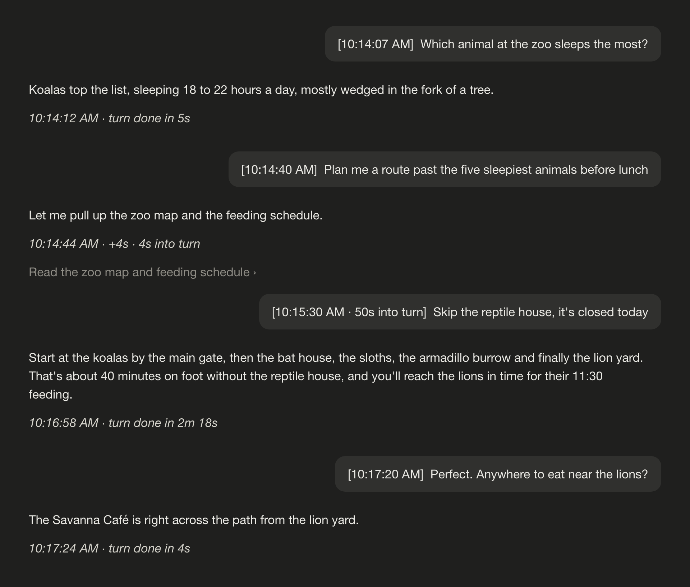

# chat-timestamps

Adds the time to every message in a Claude Code conversation, so you can tell how long something took without timing it yourself.

- **Your messages** start with the time you pressed Enter: `[9:19:28 AM]  can you…`
- **A message you type while Claude is working** shows how far into the turn it came: `[9:20:15 AM · 47s into turn]`
- **Each of Claude's text blocks** ends with its time, the gap since the previous message, and the time into the turn: *9:19:31 AM · +3s · 3s into turn*
- **The turn's last block** switches to the turn's total once the turn ends: *9:19:47 AM · turn done in 19s*

The turn's clock runs from the prompt that started it; messages you send mid-turn get their own time but don't restart it. The total is Claude Code's own measure of the turn.



## Install

See [Install](../../README.md#install) in the repository's README, which also has a prompt you can paste into Claude Code to have it install the mod for you.

## How it works

The mod notes the time when you submit a message and when each message is stored in the conversation, then adds the label as the message is drawn. It changes only what you see: the stored conversation and what Claude reads stay as they were.

Some messages are drawn under a different id than the one they are stored under (Claude's replies and queued messages in the Desktop app), so the mod also files each time under a fingerprint of the message's text and finds it that way. A label therefore appears once a reply has finished streaming, not while it streams.

## What it reads and calls

`claude plugin validate` lists it; in short:

- **Hooks**: `session.start`, `prompt.submit`, `session.append`, `turn.complete`, and `ui.render` for the `UserMessage` and `AssistantMessage` components
- **Calls**: `$.clock.now`, `$.state.get` / `$.state.set` (the session's own memory), and `$.process.run` once per session to read your UTC offset (`date +%z`, or PowerShell on Windows)
- No network, no files, nothing stored past the session

## Known limits

- Times live for the session only: a conversation reopened later shows no labels on its earlier messages, and nothing from before the mod loaded is labelled.
- Two messages with the same text share a time (the later one's).
- When the Desktop app holds several typed messages and delivers them together, each one shows the time they were delivered, not typed.
- The Windows time-zone lookup has not been tried on Windows yet.

## Tests

```bash
claude plugin test mods/chat-timestamps
```
